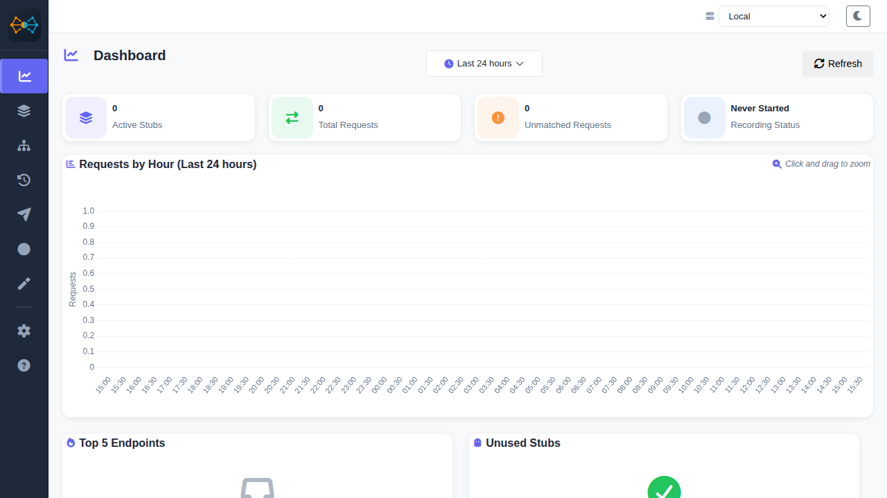
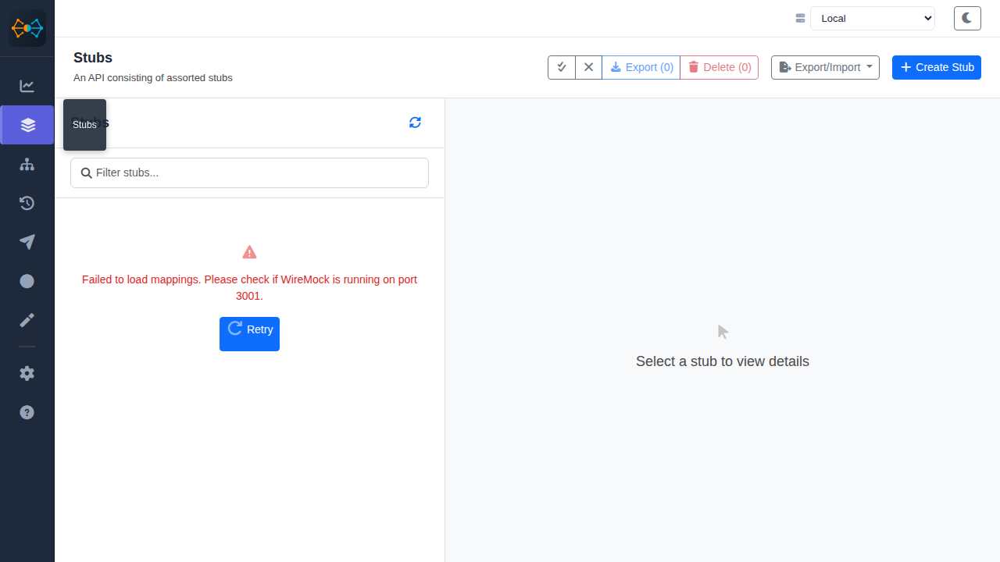
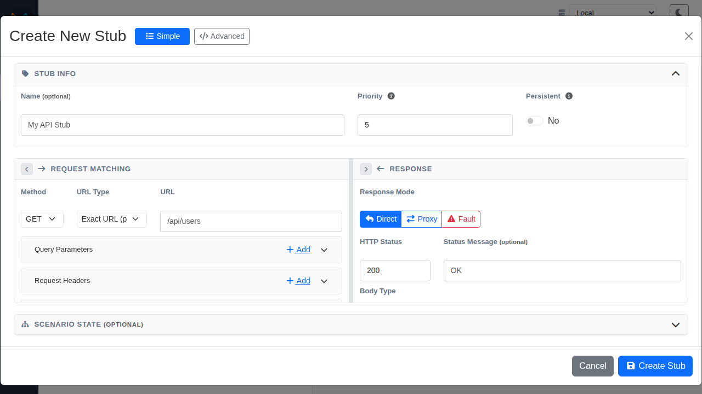
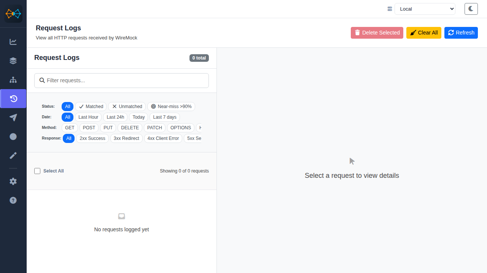
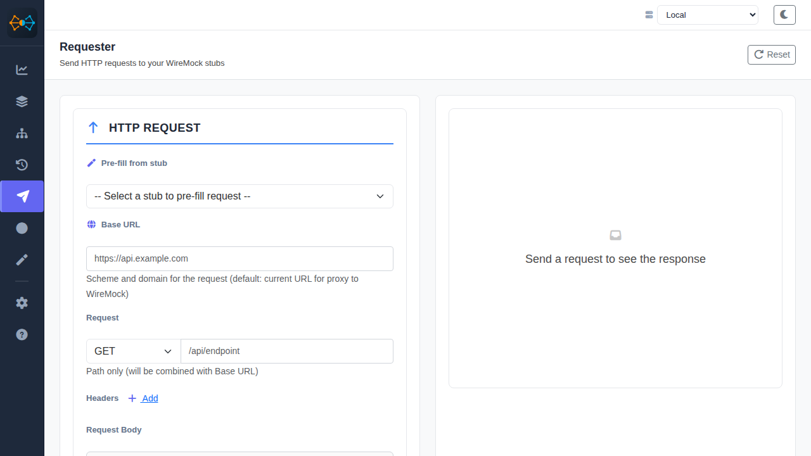
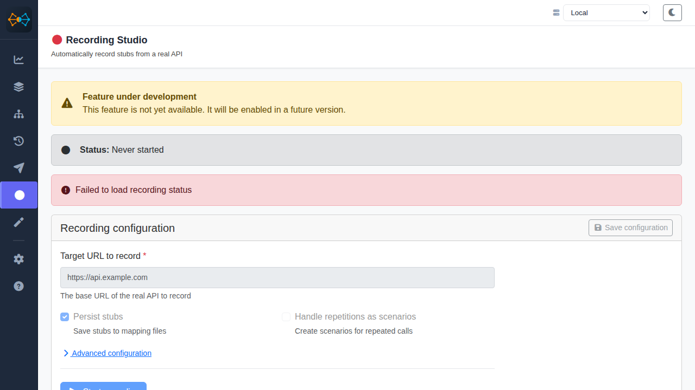

# WireMock UI — Web GUI for WireMock

WireMock UI is an open-source, self-hosted web UI/GUI for WireMock. Manage stub mappings, inspect matched and unmatched requests, record from a live API, and test with a built-in HTTP client—without hand-editing JSON or calling the Admin API.



## Architecture

```text
┌─────────────────────┐
│   Angular Web UI    │  http://localhost:4200
│   (Port 4200)       │
└─────────┬───────────┘
          │ REST API
          ▼
┌─────────────────────┐
│   WireMock Server   │  http://localhost:8080
│   (Port 8080)       │
│   Docker/Standalone │
└─────────────────────┘
```

[](https://github.com/antoine-vaisset-pro/wiremock-ui/releases)
[](https://github.com/antoine-vaisset-pro/wiremock-ui/actions/workflows/ci.yml)
[](LICENSE)
[](https://angular.dev/)
[](https://wiremock.org/)

## Try it in 30 seconds

Run the published multi-architecture image and point it at WireMock:

```bash
docker run --rm -p 4200:8080 \
  -e WIREMOCK_BACKEND=http://host.docker.internal:8080 \
  ghcr.io/antoine-vaisset-pro/wiremock-ui:latest
```

Open <http://localhost:4200>. Multiple backends can be supplied as a semicolon-separated list. They appear in the selector with an `[ENV]` badge and cannot be edited in the UI.

For a complete local stack:

```yaml
services:
  wiremock:
    image: wiremock/wiremock:3.10.0
    ports: ["8080:8080"]
  ui:
    image: ghcr.io/antoine-vaisset-pro/wiremock-ui:latest
    ports: ["4200:8080"]
    environment:
      WIREMOCK_BACKEND: http://wiremock:8080
```

## Why WireMock UI?

| Option | Best suited for | Trade-off |
|---|---|---|
| WireMock UI | Self-hosted visual management and testing | You operate the UI and WireMock server |
| Raw Admin API | Automation and scripts | No visual browsing or interactive workflow |
| WireMock Studio | Visual WireMock workflows | Proprietary product and discontinued |
| WireMock Cloud | Hosted WireMock environments | SaaS service and hosted deployment model |

WireMock UI is Apache-2.0 licensed and free for commercial and enterprise use.

## Features

### Dashboard
- Overview of active stubs and recent request statistics
- Time-range filters (last hour, last 24 hours, today, and last 7 days)
- Requests-by-hour charts and endpoint summaries powered by Chart.js
- Unused-stub and recording-status indicators


### Stub mappings
- Paginated list of stub mappings (20 per page)
- Real-time search by URL, method, name, or JSON body
- Color-coded HTTP method badges
- Detailed request and response views with formatted JSON
- Import JSON files in both `[...]` and `{"mappings": [...]}` formats, with preview
- Export all stubs or a selection to JSON
- Bulk selection for export and deletion




### Request logs
- Full history of requests received by WireMock
- Matched, unmatched, and near-miss (>90%) filters
- Filters by time range, HTTP method, and response code
- Smart status badges for matched, near-miss, and unmatched requests
- Expandable headers, bulk selection, and bulk deletion
- One-click navigation from a request to its matching stub



### HTTP requester
- Built-in HTTP client for testing stubs directly from the UI
- Support for all HTTP methods and custom headers
- Pre-fill requests from an existing stub
- Full response display including status, headers, body, and response time



### Recording Studio
- Automatically record stubs from a real API target
- Configure URL filters, methods, headers, and repetitions
- Poll recording status in real time
- Save and reload named recording configurations
- Export recorded mappings



### OpenAPI stub generator
- Parse OpenAPI 2 and 3 specifications
- Generate multiple WireMock stub variants per endpoint
- Edit generated stubs before importing them
- Validate supported OpenAPI versions and inspect generated mappings

### Scenarios, settings, and help
- View and manage stateful WireMock scenarios
- Reset scenario state
- Select local, environment, and saved custom backends
- Use searchable in-app help and documentation

## Development

### Prerequisites

- Node.js >= 22.12.0 and npm
- Docker (for WireMock and the Docker image)

```bash
git clone https://github.com/antoine-vaisset-pro/wiremock-ui.git
cd wiremock-ui
make install
```

Start the full development stack with `make dev-full`, or use `make docker-up` for the production-like Nginx image. The UI is at <http://localhost:4200> and WireMock's Admin API is at <http://localhost:8080/__admin/>.

### Service URLs

| Service | URL | Description |
|---|---|---|
| Web UI | <http://localhost:4200> | Angular interface |
| WireMock Admin | <http://localhost:8080/__admin/> | WireMock Admin REST API |
| WireMock mappings | <http://localhost:8080/__admin/mappings> | Raw JSON stub list |
| Mock endpoints | <http://localhost:8080/...> | Configured mocked API routes |

```bash
make help
make build
make test
make docker-build
make docker-down
```

### Configuration

The Angular development proxy routes `/__admin` and `/api` to `http://localhost:8080`. For a production image, set `WIREMOCK_BACKEND` at container runtime:

```bash
WIREMOCK_BACKEND=https://staging.example.com;https://prod.example.com make docker-up
```

The build-time variable remains supported by `npm run build` and `docker build --build-arg WIREMOCK_BACKEND=...`; a runtime value takes precedence.

See [docs/PRODUCTION_DEPLOYMENT.md](docs/PRODUCTION_DEPLOYMENT.md) and [docs/DEVELOPER_GUIDE.md](docs/DEVELOPER_GUIDE.md).

## Troubleshooting

**The UI shows a connection error**

Verify that WireMock is running and reachable:

```bash
curl http://localhost:8080/__admin/mappings
```

**CORS errors occur in development**

Make sure the Angular proxy is active. Restart with `make dev` and verify that `proxy.conf.js` is referenced by `angular.json`.

**A port is already in use**

Stop the process using port 4200 (Angular) or 8080 (WireMock) before starting the stack.

## Project structure

```text
wiremock-ui/
├── src/main/webapp/          # Angular application and CHANGELOG.md
│   ├── src/app/              # Components, pages, services, and models
│   └── public/               # Runtime configuration defaults
├── docker/                   # Dockerfile, Compose, and Nginx template
├── docs/                     # Deployment, developer guide, API reference, screenshots
├── scripts/                  # Screenshot and maintenance scripts
├── Makefile                  # Development commands
├── LICENSE                   # Apache License 2.0
└── NOTICE                    # Copyright and project notice
```

## Contributing

See [CONTRIBUTING.md](CONTRIBUTING.md). Please use Conventional Commits and include tests for new behavior.

## License

WireMock UI is licensed under the [Apache License 2.0](LICENSE). Versions from 1.1.0 onward are Apache-2.0 licensed.

## Acknowledgements

- [WireMock](https://wiremock.org/) — the HTTP mock server this UI is built on
- [Angular](https://angular.dev/) — the frontend framework
- [Bootstrap](https://getbootstrap.com/) — UI components
- [Chart.js](https://www.chartjs.org/) — dashboard charts (MIT License)
